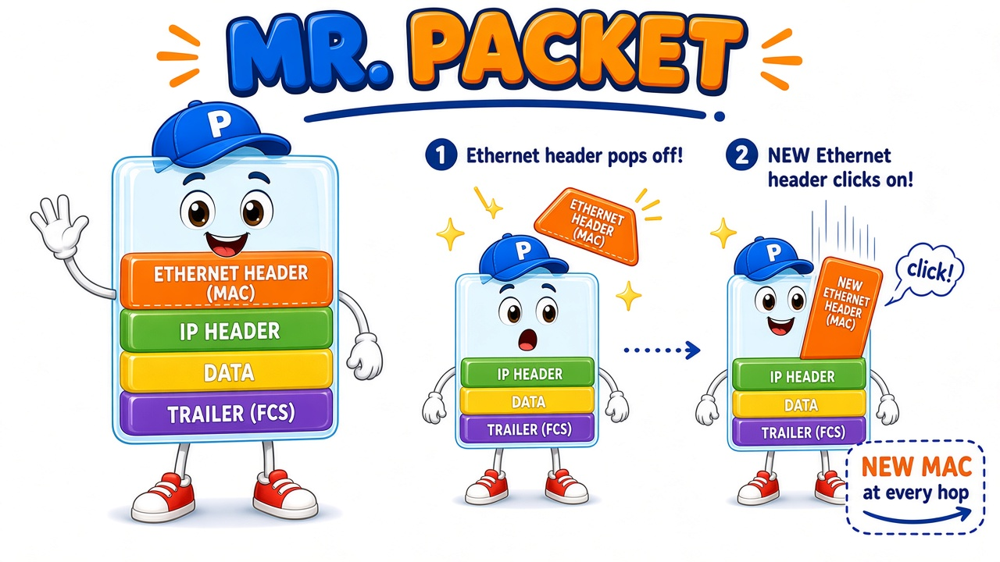
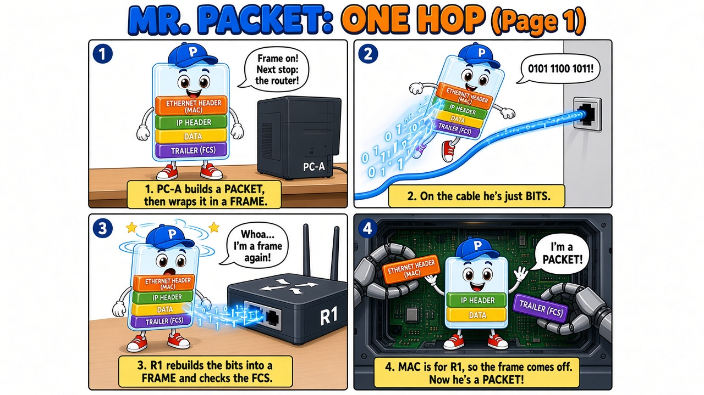
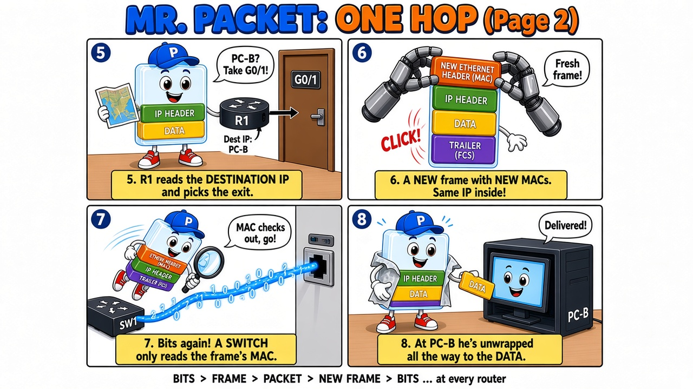

# A Day in the Life of a Packet

Meet **Mr. Packet**, a see-through little guy who shows what really happens to your data as it crosses a network, one hop at a time.

Created by **Innocent Nkosiyethu Mbatha**, CCNA candidate, as a fun way to explain the frame-and-packet process from the CCNA course.

## Who is Mr. Packet?

Mr. Packet's body is transparent, so you can see his layers:

| Layer | What it holds | OSI layer | Changes at each router? |
|---|---|---|---|
| Ethernet header | Source and destination **MAC** | Layer 2 | **Yes**, new one every hop |
| IP header | Source and destination **IP** | Layer 3 | No, stays the same end to end |
| Data | The actual message | Upper layers | No |
| Trailer (FCS) | Error check for the frame | Layer 2 | **Yes**, rebuilt with the new frame |

- With all four layers on, he's a **frame** (Layer 2).
- With the Ethernet header and trailer off, he's a **packet** (Layer 3).
- On the cable he's neither. He's just **bits** (Layer 1): electrical signals on copper, light on fibre, or radio waves on Wi-Fi.

## Episode 1: One Hop

## What happens at each hop

1. **PC-A** builds a packet (IP header + data) and wraps it in a frame (Ethernet header + trailer).
2. The NIC sends the frame onto the cable as **bits**.
3. **Router R1** rebuilds the bits into a **frame** and checks the FCS.
4. The destination MAC is R1's own, so R1 removes the Ethernet header and trailer. Now he's a **packet**.
5. R1 reads the **destination IP**, checks its routing table and picks the exit interface.
6. R1 puts on a **new frame** with new source and destination MACs for the next hop. The IP header doesn't change.
7. He goes out as **bits** again. A **switch** on the way only rebuilds the frame and reads the **MAC**. It never opens the packet.
8. At **PC-B** he's unwrapped all the way down to the data.

> **Bits → frame → packet → new frame → bits**, repeated at every router.

## Key takeaways

- **Bits** travel on the wire. Frames and packets are just names for how those bits are grouped.
- **MAC addresses are local** and change at every router hop.
- **IP addresses are end to end** and stay the same from source to destination (ignoring NAT).
- **Switches work with frames (L2)**, and **routers work with packets (L3)**.

---

*Part of my CCNA learning journey. More episodes coming.*
